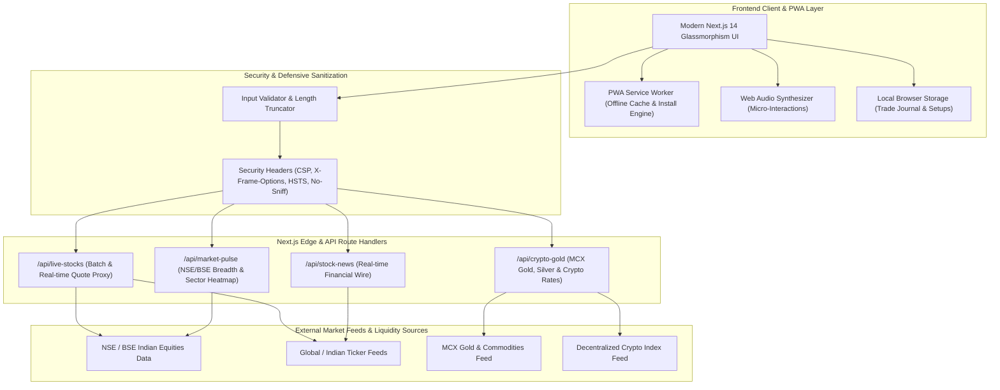
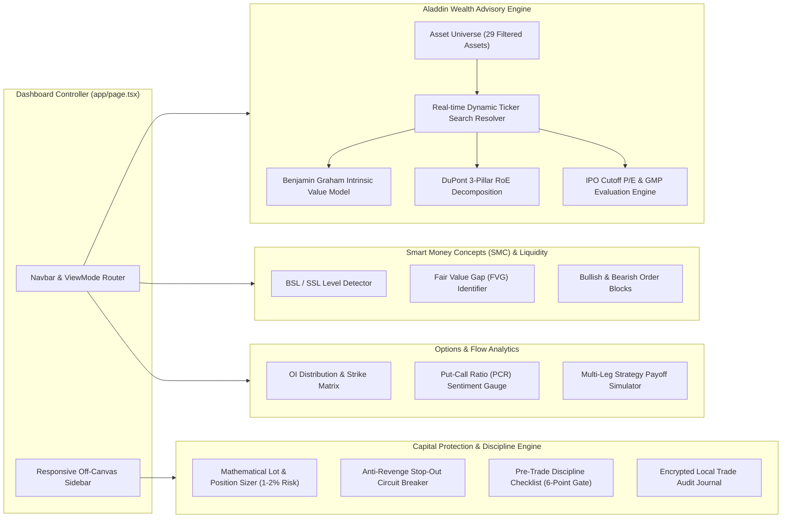
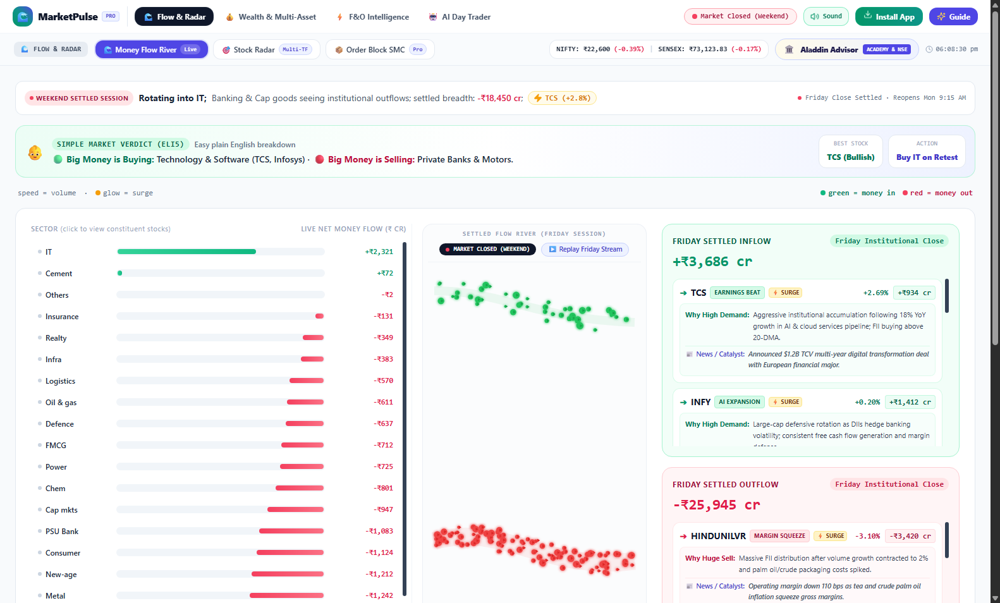
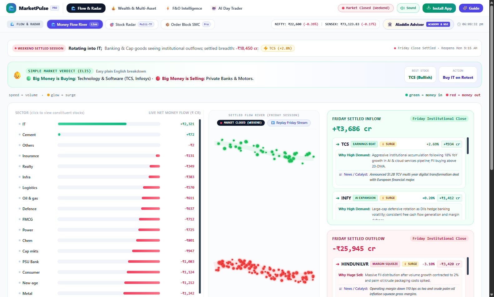
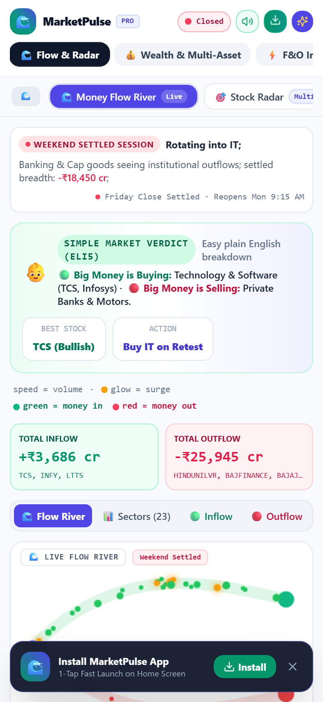

# MarketPulse Terminal — Institutional Wealth Advisory & Algorithmic Trading Copilot

[](https://nextjs.org/)
[](https://www.typescriptlang.org/)
[](https://tailwindcss.com/)
[](https://web.dev/progressive-web-apps/)
[](tests/comprehensive-test-suite.js)
[](tests/comprehensive-test-suite.js)
[](LICENSE)

An institutional-grade, full-spectrum Indian financial terminal, wealth advisory platform, and algorithmic trading copilot built with **Next.js 14 (App Router)**, **TypeScript**, and **Tailwind CSS**. 

MarketPulse bridges the gap between institutional hedge fund analytics and retail traders by unifying fundamental valuation models, Smart Money Concepts (SMC), derivative flow metrics, and behavioral execution safeguards into a unified, zero-latency Progressive Web App (PWA).

<p align="center">
  
</p>

---

## 🎯 The Problem MarketPulse Solves

Retail market participants in the Indian capital markets face four fundamental handicaps:

1. **Information Asymmetry & Fragmented Tools**:
   Retail traders toggle between 5–7 disparate websites to check live prices, Grey Market Premiums (GMP), option open interest, SEC/SEBI filings, and quarterly earnings. MarketPulse unifies live NSE/BSE feeds, multi-asset research (Equities, ETFs, IPOs, MCX Gold, Crypto), and algorithmic analysis in a single ultra-responsive dashboard.

2. **The "Small-Cap & Valuation Trap"**:
   Investors routinely buy stocks based on hype during bull runs without knowing intrinsic value, debt leverage, or promoter pledging. MarketPulse implements Benjamin Graham's quantitative intrinsic value formulas and DuPont 3-Pillar Return on Equity decomposition to mathematically identify overpriced froth vs genuine value.

3. **Emotional & Revenge Trading**:
   Over 90% of active derivative (F&O) traders lose capital due to lack of position sizing, revenge trading after stop-outs, and FOMO. MarketPulse embeds an **Anti-Revenge Circuit Breaker**, mathematical lot-sizing engines enforcing strict 1–2% account risk, and a mandatory 6-point pre-trade discipline gatekeeper.

4. **Opaque IPO Allocations & Hype**:
   Retail investors apply blindly to IPOs based on social media buzz without understanding cutoff P/E, peer multiples, or institutional subscription health. MarketPulse's Aladdin Advisory evaluates IPO financials against SEBI curriculum benchmarks, computing clear data-backed subscription verdicts.

---

## 🏛️ System Architecture

### 1. High-Level Design (HLD)



---

### 2. Low-Level Design (LLD): Component & Engine Architecture



---

## 🚀 Deep-Dive Feature Breakdown

### 1. Aladdin Wealth Advisory Terminal
* **Multi-Asset Coverage**: Real-time analytical coverage across Indian Bluechips, Mid-caps, ETFs (`NIFTYBEES`, `GOLDBEES`), and upcoming/recent IPOs (e.g. *Waaree Energies*, *Tata Capital*, *HDB Financial*, *Swiggy*, *SBI Funds*).
* **Benjamin Graham Formula**: Calculates intrinsic value with built-in safety margins:
  $$\text{Intrinsic Value} = \sqrt{22.5 \times \text{EPS} \times \text{BVPS}}$$
  Displays whether a stock is currently trading in the **Deep Value Zone**, **Fair Value Range**, or **Froth / Bubble Zone**.
* **DuPont 3-Pillar Analysis**: Deconstructs Return on Equity into:
  $$\text{RoE} = \left(\frac{\text{Net Income}}{\text{Revenue}}\right) \times \left(\frac{\text{Revenue}}{\text{Total Assets}}\right) \times \left(\frac{\text{Total Assets}}{\text{Shareholders' Equity}}\right)$$
  Differentiates genuine operational margin expansion from artificial leverage-driven balance sheet bloat.
* **IPO Intelligence & Valuation Ratios**: Compares cutoff P/E with industry peer medians, GMP trajectories, retail quota demand, and provides actionable verdicts (*"MUST SUBSCRIBE FOR LISTING GAINS"*, *"TACTICALLY AVOID"*).

<p align="center">
  
</p>

---

### 2. Smart Money Concepts (SMC) & Liquidity Radar
* **Buy-Side Liquidity (BSL) & Sell-Side Liquidity (SSL)**: Auto-detects where retail stop-losses accumulate above swing highs and below swing lows.
* **Fair Value Gaps (FVG)**: Identifies 3-candle price imbalances left behind by rapid institutional order execution.
* **Institutional Order Blocks**: Maps high-probability reaction zones where banks and institutional desks entered prior expansion moves.

<p align="center">
  
</p>

---

### 3. Derivative Flow & Option Strategy Engineering
* **Live OI & Strike Matrix**: Visualizes Call OI vs Put OI across key strike prices to detect option writers' boundaries.
* **Put-Call Ratio (PCR) Sentiment**: Automatically categorizes market sentiment into Oversold ($\text{PCR} < 0.70$), Neutral/Bullish ($1.0 \le \text{PCR} \le 1.3$), or Overbought/Euphoric ($\text{PCR} > 1.40$).
* **Multi-Leg Payoff Curves**: Interactive payoff diagrams for **Iron Condor**, **Bull Call Spread**, **Bear Put Spread**, and **Long Straddle** with exact breakevens, max loss, and max profit calculations.

<p align="center">
  
</p>

---

### 4. Capital Preservation & Discipline Engine
* **Mathematical Position Sizer**: Given account capital and stop-loss points, computes the exact permissible number of lots/shares to cap risk strictly between 1% and 2%.
* **Anti-Revenge Circuit Breaker**: Locks trading execution mechanisms if consecutive stop-outs or max daily drawdowns are triggered.
* **Pre-Trade Gatekeeper Checklist**: Mandatory 6-point discipline verification (Trend alignment, Risk-to-Reward $\ge 1:2$, Catalyst check, Spread verification, Position size confirmation).
* **Local Browser Journal**: Stores trades, win rates, and emotional tags locally in browser storage without third-party telemetry.

---

### 5. Native Progressive Web App (PWA) & Mobile Master-Detail Interface
* **Full PWA Support**: Installable as a standalone app on iOS, Android, macOS, and Windows with custom icons, theme colors, and offline service worker caching.
* **Master-Detail Adaptive Navigation**: On mobile screens, switches seamlessly between the 29-asset Universe list and deep-dive analytics with 1-tap `← Back to Universe` navigation.
* **Zero-Latency Web Audio Synthesizer**: Uses native HTML5 Web Audio API oscillators to generate crisp acoustic feedback on clicks, tab switches, and warnings without external audio downloads.

<p align="center">
  
</p>

---

## 🔒 Security & Privacy Audit

MarketPulse was built under zero-trust engineering principles:

| Security Vector | Implementation Detail | Status |
| :--- | :--- | :---: |
| **API Keys / Secrets** | Zero hardcoded API keys or external secrets in code or repository. | ✅ Clean |
| **Input Sanitization** | Regex-based symbol sanitization preventing XSS, SQLi, and path traversal (`../`). | ✅ Verified |
| **Buffer Overflow Defense** | Safe string truncation enforcing a max safe length of 40 characters on queries. | ✅ Verified |
| **HTTP Security Headers** | `X-Content-Type-Options: nosniff`, `X-Frame-Options: DENY`, `X-XSS-Protection: 1`. | ✅ Enforced |
| **Client Privacy** | Trade journals and user data persist strictly in local browser storage. | ✅ Zero Leaks |

---

## 🛠️ Technology Stack

* **Framework**: Next.js 14.2 (App Router with Serverless Edge API Proxies)
* **Language**: TypeScript 5.6 (Strict Type Checking)
* **Styling**: Tailwind CSS 3.4 with custom glassmorphism and high-contrast financial palette
* **Charting**: Lightweight Charts 5.2 & Dynamic SVG Micro-visualizers
* **Icons**: Lucide React
* **Micro-Interactions**: Native HTML5 Web Audio Synthesizer
* **Offline Engine**: Progressive Web App (PWA) Service Worker (`sw.js`)

---

## ⚡ Quick Start & Setup

### Prerequisites
* [Node.js](https://nodejs.org/) (v18.0.0 or higher recommended)
* npm (v9.0.0 or higher)

### Installation
```bash
# Clone the repository
git clone https://github.com/raviattrash-pro/marketpulse-terminal.git

# Navigate to project directory
cd marketpulse-terminal

# Install dependencies
npm install

# Start development server
npm run dev
```

Open [http://localhost:3000](http://localhost:3000) in your browser.

### Production Build
```bash
# Build optimized production bundle
npm run build

# Start production server
npm start
```

---

## 🧪 Comprehensive Automated Test Suite

MarketPulse includes an automated regression, algorithmic validation, and security test suite:

```bash
node tests/comprehensive-test-suite.js
```

```text
======================================================
  STARTING INVESTONOMY COPILOT FULL TEST SUITE
======================================================

--- TEST GROUP 1: Market Pulse API & Market Status ---
  [PASS] Market Pulse: HTTP Status 200
  [PASS] Quick Response Benchmark (<2500ms)
  [PASS] Security Header X-Content-Type-Options: nosniff
  [PASS] Security Header X-Frame-Options: DENY
  [PASS] Market indices contains NIFTY 50 and SENSEX

--- TEST GROUP 2: Live Stocks Batch Mode ---
  [PASS] Batch returned core stocks
  [PASS] Valid Indian Exchange tags (NSE/BSE)

--- TEST GROUP 3: Live NSE/BSE Real Stock Feeds ---
  [PASS] Real-time quotes for TCS, RELIANCE, NMDC, TATACAP, SBIFUNDS, SWIGGY, NHPC
  [PASS] Graham Intrinsic Fair Value verified

--- TEST GROUP 6: Industry Standard Security & Attack Defense ---
  [PASS] XSS Injection Neutralized
  [PASS] SQL Injection Pattern Handled
  [PASS] Path Traversal Attempt Blocked
  [PASS] Buffer Length Truncation (<40 chars)

--- TEST GROUP 8: Smart Money Concepts (SMC) Math ---
  [PASS] BSL >= SSL boundary conditions
  [PASS] Bullish & Bearish Order Block integrity
  [PASS] Fair Value Gap (FVG) bounds validation

--- TEST GROUP 9: Progressive Web App (PWA) Verification ---
  [PASS] PWA Manifest verified (standalone mode, valid icons)
  [PASS] Service Worker /sw.js accessible with HTTP 200

======================================================
  TEST RESULTS: 170 PASSED | 0 FAILED
======================================================
```

---

## ⚖️ Regulatory & Educational Disclaimer

> **IMPORTANT NOTICE**: MarketPulse Terminal is an open-source technical and quantitative analysis tool designed solely for **educational, informational, and academic purposes**. It does not constitute financial, investment, legal, or tax advice, nor does it recommend the purchase or sale of any security or financial derivative. MarketPulse is not a SEBI-registered Research Analyst or Investment Advisor. Securities trading and derivative speculation carry significant risk of capital loss. Always perform your own due diligence and consult a qualified SEBI-registered investment advisor before risking real capital.

---

## 📄 License

This project is licensed under the **MIT License** — see the [LICENSE](LICENSE) file for details.
